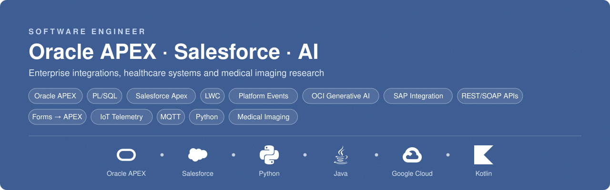

<!-- English version of the profile README, CV style. -->

<a href="README.md">Español</a> · <b>English</b>

# Oscar Leonardo Pedrozo

**Software Engineer**: Oracle APEX · Salesforce · Data & Integrations 
Asunción, Paraguay · [LinkedIn](https://www.linkedin.com/in/oscar-leonardo-pedrozo) · [GitHub](https://github.com/LeoPedrozo)

---

### Summary

Computer Engineer, graduated with distinction from FP-UNA, with over 4 years of experience in enterprise development on **Oracle APEX** and **Salesforce**. I took part in migrating a healthcare system from Oracle Forms 6i to APEX, integrated Salesforce with core systems and SAP, and built a fleet telemetry solution with Platform Events, REST APIs and MQTT. I am currently developing AI projects with Oracle APEX and the new AI features in version 26.2. I complement my work with research in medical image processing, with papers presented in Brazil and Colombia.

---

### Experience

**Salesforce Developer**, Freelance 
*January 2026 – Present*
- Built a second-generation Salesforce package (2GP) for telemetry and tracking of a logistics vehicle fleet, on Sales Cloud.
  - Real-time position and work-route tracking, idle-time monitoring, and multi-sensor logging per vehicle.
  - Pub/sub architecture with Platform Events to process telemetry events.
  - Apex REST API with GET, POST and PUT operations, consumed by an external platform that integrates the leading fleet-telemetry APIs.
  - Lightning Web Components (LWC) interface with interactive Leaflet maps.
  - Configured permissions for access to the system and its classes.
- Extended an open-source Kotlin Android app for field staff tracking, adding MQTT over TLS support and sensor readings.

**Oracle APEX Developer**, Excelsis S.A. 
*June 2024 – Present*
- Develop and optimize medical systems applications with PL/SQL and Oracle APEX.
- Design complex database triggers, procedures and functions to improve system logic.
- Implement reporting solutions with Jasper Reports.
- Deliver software modules on schedule using Agile methodologies.
- **AI customer-service assistant for a medical ERP** (2026, in production): chatbot built on Oracle APEX 26.2 for an ERP used by hospitals, clinics and prepaid healthcare providers in Paraguay.
  - Integrated OCI Generative AI with a recent xAI Grok model as the assistant's engine.
  - Centralized customer information retrieved through PL/SQL to provide context-aware answers.
  - Protected sensitive patient information through data encryption.
- **On-site consulting for a prepaid healthcare provider** (May – August 2026): successfully completed the migration of its system from Oracle Forms 6i to Oracle APEX 22.1.
  - Analyzed and built Oracle APEX pages to migrate Forms 6i screens and business logic.
  - Served as liaison between the client and the development team, gathering and translating requirements.
  - Improved PL/SQL triggers and procedures.
  - Supported report development with Jasper Reports.
  - Advised the client on planning future migrations to newer Oracle APEX versions.

**Salesforce Developer**, Excelsis S.A. 
*April 2023 – June 2024*
- **Brokerage firm:** integrated leads and accounts from its core system into Salesforce Sales Cloud, end to end, using Apex and the Salesforce SOAP and REST APIs.
- **Machinery sales:** built custom Salesforce forms for the sales process and integrated Salesforce with SAP through its SOAP API.
- **Automotive company:** cleaned up and merged duplicate records with Pentaho ETL processes and the Salesforce Bulk API, automated with Python (Pandas) in Jupyter Notebook.
- Supported and maintained system integrations with Salesforce.

**Support & Development**, National Securities Commission (CNV), Paraguay 
*August 2022 – March 2023*
- Gathered requirements to implement a document management system on Salesforce Sales Cloud for CNV.
- Developed data-availability APIs with Django and Python.
- Maintained the institutional WordPress site and built new PHP pages listing bond issuers.
- Administered Windows and Ubuntu servers and monitored backup systems (Veeam).

---

### Education

- **B.Sc. in Computer Engineering**, Facultad Politécnica, UNA. *Graduated with distinction, November 2025*
- **Specialization in Higher Education Teaching**, Facultad Politécnica, UNA. *July 2026 – April 2027 (in progress)*
- **Postgraduate Diploma in IoT and Embedded Systems**, FP-UNA. *May 2025*
- **Summer School on Medical Informatics with AI**, UNAM (Mexico). *August 2025*
- **English**, Centro Cultural Paraguayo Americano (CCPA), completed up to the "Avanzado Superior 2" (Upper Advanced 2) course. *2015 – 2018*

---

### Certifications

- Google Cloud Digital Leader. *Google, 2026*
- Oracle Certified Professional (OCP). *Oracle, 2025*
- Salesforce Certified AI Associate. *Salesforce, 2024*
- Salesforce Certified Platform Foundations. *Salesforce, 2023*

---

### Research

**Registration of CT and MR medical images with the Contour-Point Signature (CPS) descriptor** 
*Research Group on Scientific Computing and Applied Mathematics, FP-UNA · September 2024 – November 2025*
- Developed a medical image registration method based on CPS, a mathematical method from the shape descriptor family: CPS represents each image's contour, and a cost matrix finds the optimal rotation and point correspondences for landmark-based registration.
- Evaluated the method on CT and MR images from the public RIRE dataset (Vanderbilt University): on a test patient's slices it reached 72.80% accuracy for 10 extracted points, with a 1% error threshold (≈ 5.12 pixels).
- Implemented the processing pipeline in Python with SimpleITK.
- Funded by FP-UNA through its Program for Strengthening Science, Technology and Innovation (2025), and sponsored by Excelsis S.A.
- Worked alongside leading researchers from FP-UNA and FIUNA in a multidisciplinary group.

### Publications & Presentations

- **"Contour-Point Signature in Registration of Tomography and Magnetic Resonance Images"**: poster at the XLIV National Congress of Applied and Computational Mathematics (CNMAC 2025), organized by SBMAC, Brazil, September 2025. Published in *Proceeding Series of the Brazilian Society of Computational and Applied Mathematics*.
- **"Eficiencia del uso del CPS en Registro de imágenes médicas"** (Efficiency of CPS in Medical Image Registration): remote talk at the V Meeting on Mathematics and Statistics Applied to the Social and Economic Sciences, Colombia, May 2025. Published in the meeting's proceedings.

---

### Technical Skills

| Area | Skills |
|---|---|
| Salesforce | Apex, LWC, Platform Events, Flows, Dashboards, SOAP/REST APIs, Bulk API, 2GP packages, Sales Cloud |
| Oracle | Oracle APEX (including its AI features), PL/SQL, SQL, Oracle Forms migration, Jasper Reports |
| Integrations | SAP (SOAP), REST APIs, MQTT/TLS, Pentaho ETL |
| Programming | Python (Pandas, NumPy), Django, Kotlin (Android), JavaScript, PHP, WordPress, Leaflet |
| Data & AI | Medical image processing (SimpleITK), Machine Learning, data cleansing and migration |
| Infrastructure & Management | Linux, Google Cloud, IoT with ESP32, Git, Jira (Scrum/Kanban) |

---

### Languages

Spanish (native) · Guarani (native) · English (advanced reading and writing, intermediate speaking)

---

### Selected Repositories

| Repository | Description |
|---|---|
| [envio_masivo_sms_vox](https://github.com/LeoPedrozo/envio_masivo_sms_vox) | PL/SQL procedure for bulk SMS sending through the Vox Paraguay API. |
| [simpleITKnotebooks](https://github.com/LeoPedrozo/simpleITKnotebooks) | Medical image processing notebooks with SimpleITK. |
| [MEIA](https://github.com/LeoPedrozo/MEIA) | Exercises from an AI training workshop. |
| [laberinto-caminocorto](https://github.com/LeoPedrozo/laberinto-caminocorto) | Shortest path through a maze, in C. |

---

### Appendix: Gallery

  
  
  

Poster at CNMAC 2025 (Brazil) · Talk and group photo at the year-end workshop of the Research Group on Scientific Computing and Applied Mathematics

